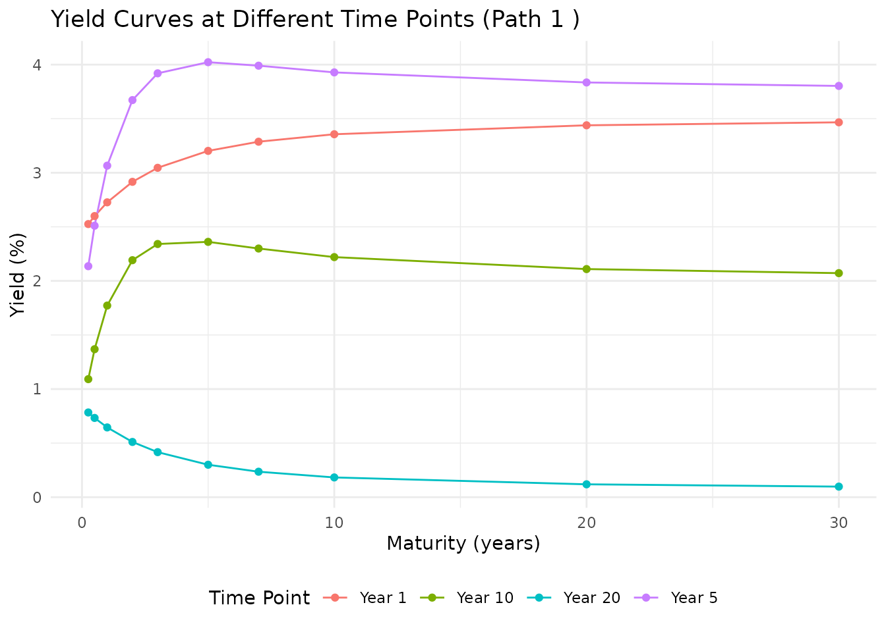
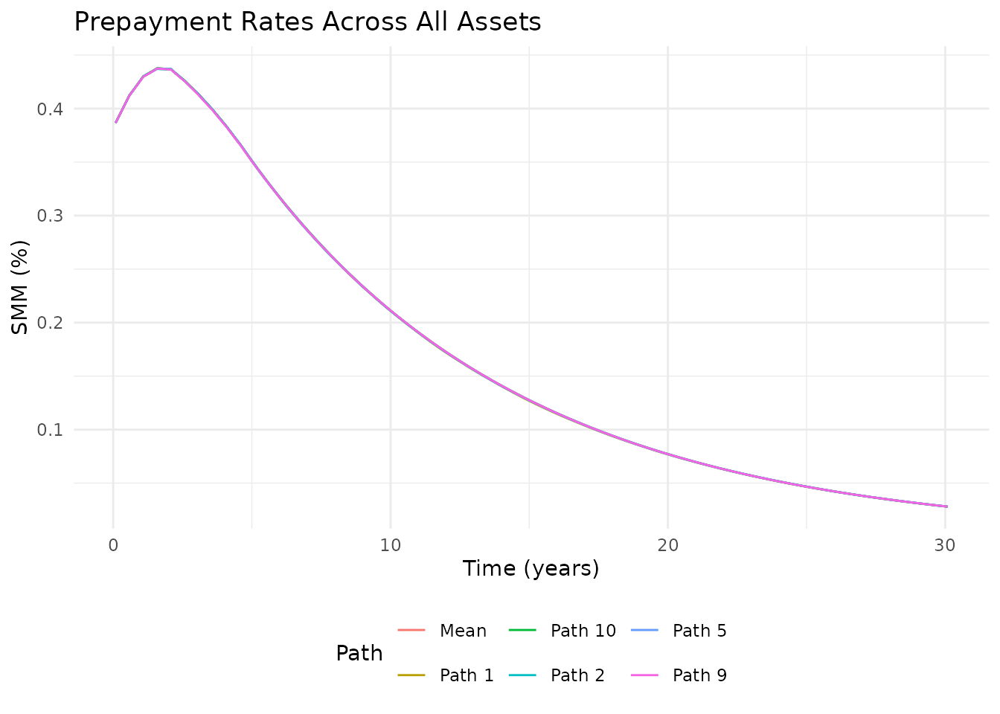
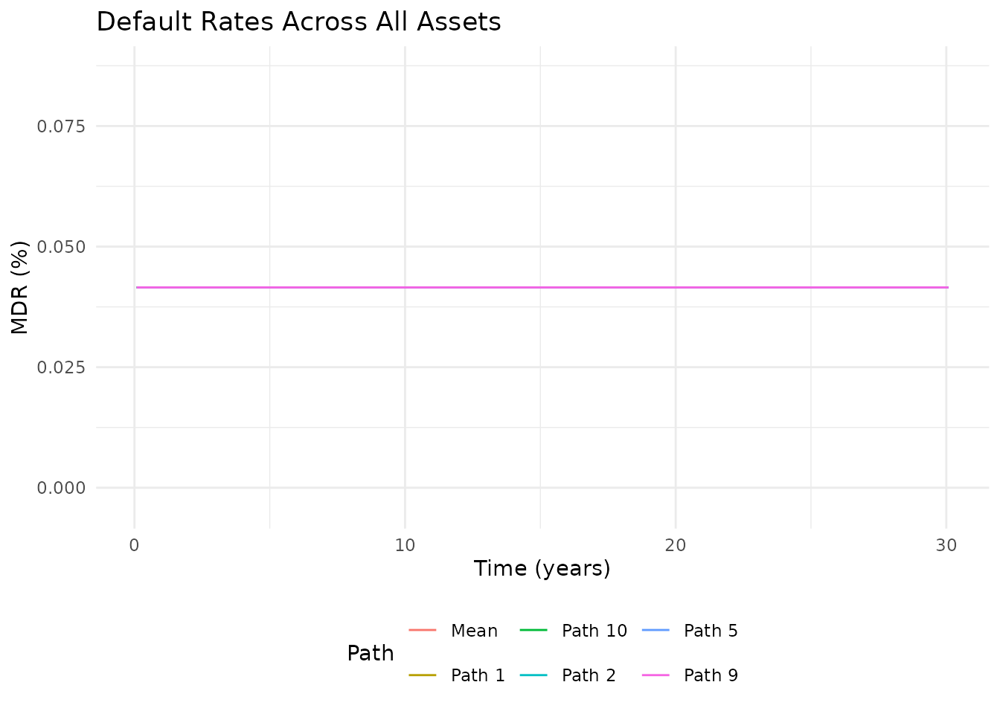
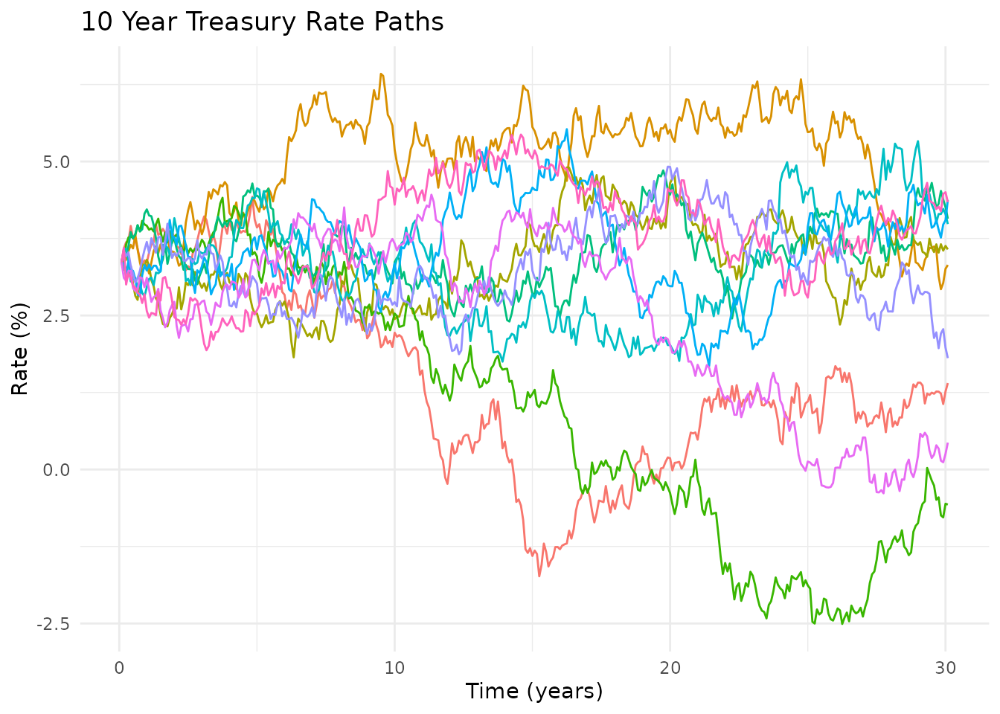
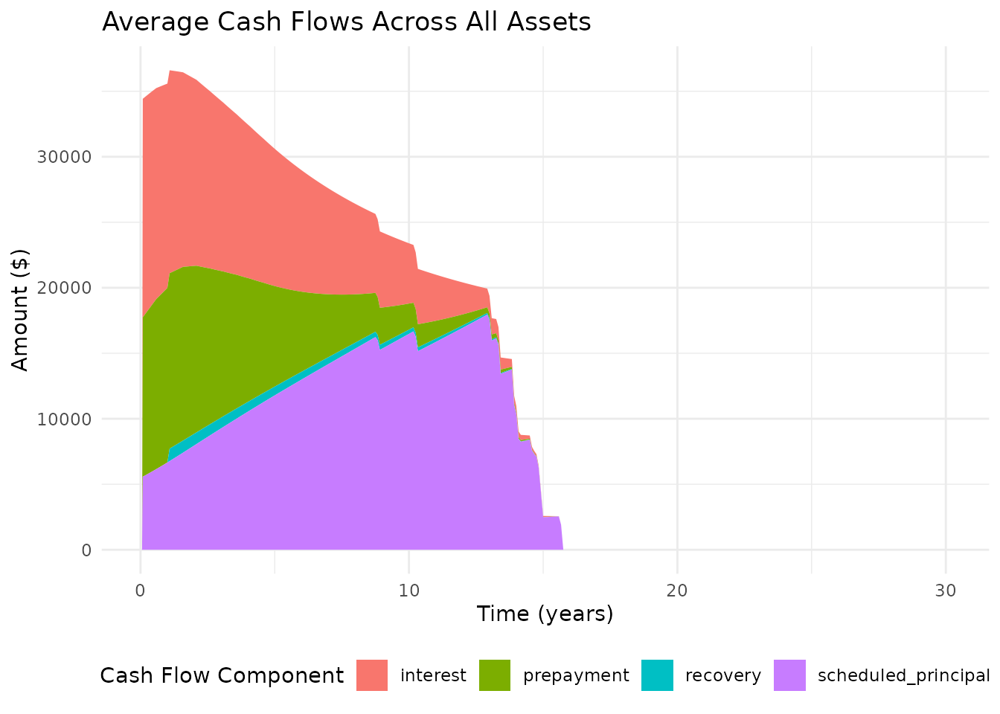
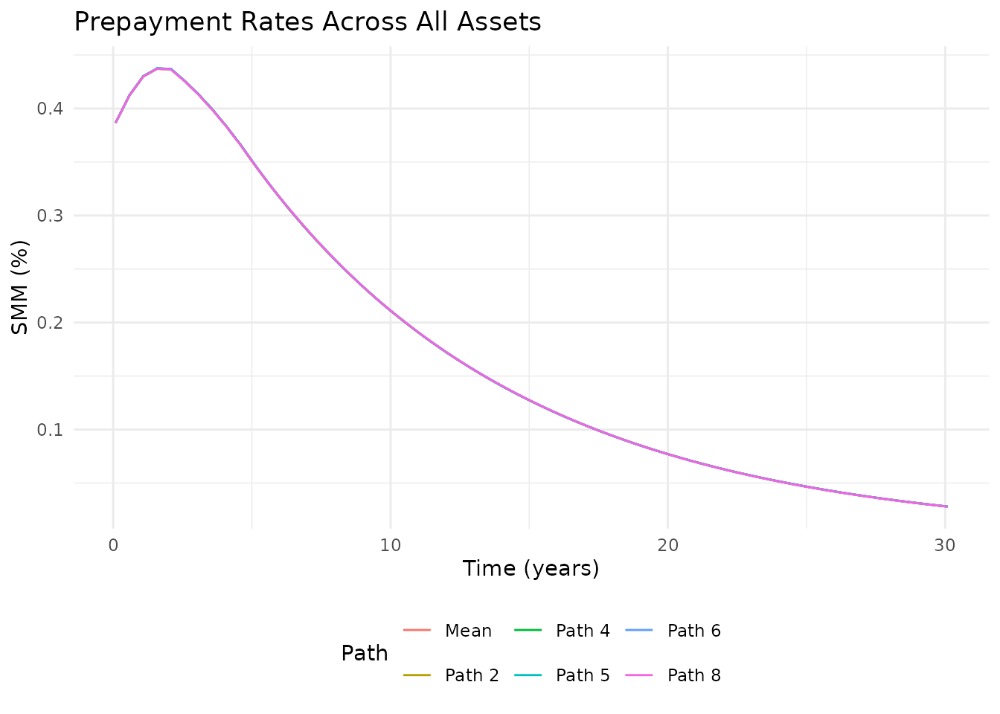
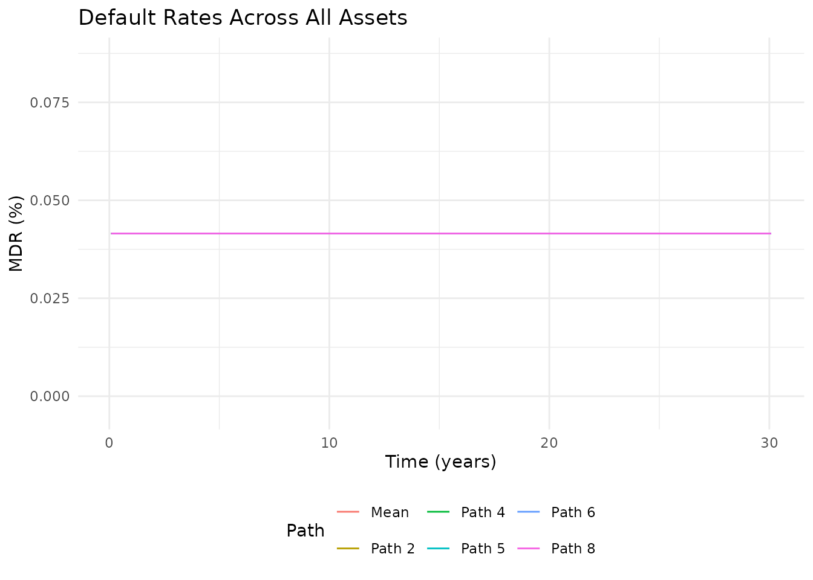
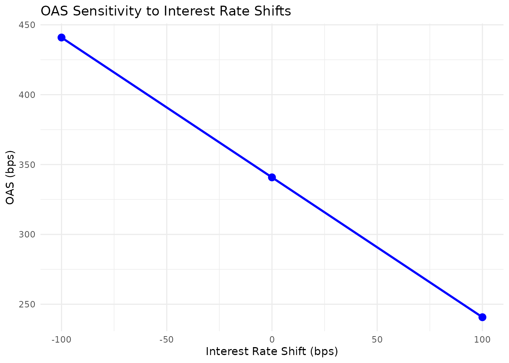

# Introduction to oasr

## Introduction

The `oasr` package provides a comprehensive toolkit for option-adjusted
spread (OAS) analysis of fixed income securities, with a focus on
asset-backed securities (ABS) and mortgage-backed securities (MBS). This
vignette demonstrates the basic workflow for performing OAS analysis
using the package.

## Installation

You can install the development version of `oasr` from GitHub:

``` r

# Install devtools if not already installed
if (!requireNamespace("devtools", quietly = TRUE)) {
  install.packages("devtools")
}

# Install oasr
devtools::install_github("ambientpointcorp/oasr")
```

## Load Required Packages

``` r

library(oasr)
library(ggplot2)  # For visualization enhancements

# dnsr is deliberately not attached. It exports plot_yield_curves() and
# plot_yield_surface() of its own, which would mask oasr's: call dnsr through
# dnsr:: instead, as below.
```

## Load Sample Data

The package includes sample data for demonstration:

``` r

# Load sample asset data
data(sample_abs_data)

# Take a look at the data
head(sample_abs_data)
#>   asset_id original_balance  balance    wac servicing io_strip accrual_method
#> 1     L001           350000 341533.6 0.0625    0.0025   0.0010         30/360
#> 2     L002           198000 186393.9 0.0550    0.0025   0.0010         30/360
#> 3     L003           425000 420781.7 0.0712    0.0030   0.0015         30/360
#> 4     L004           150000 128072.5 0.0488    0.0025   0.0010         30/360
#> 5     L005           275000 258158.2 0.0675    0.0030   0.0015         30/360
#> 6     L006           520000 438256.4 0.0425    0.0025   0.0010         30/360
#>   term age  ltv fico state property_type occupancy_type
#> 1  360  24 0.80  742    CA           SFR        PRIMARY
#> 2  360  48 0.72  768    NY           SFR        PRIMARY
#> 3  360  12 0.90  668    FL         CONDO     INVESTMENT
#> 4  180  36 0.65  790    TX           SFR        PRIMARY
#> 5  360  60 0.85  705    IL         MULTI     INVESTMENT
#> 6  360  96 0.58  781    WA           SFR        PRIMARY
```

## Simulate Interest Rate Paths

First, we need to simulate interest rate paths using the `dnsr`
package’s DNS model capabilities:

``` r

# In a real analysis, we would calibrate DNS parameters from market data
# dns_params <- dnsr::get_calibrated_dns_params()

# For this vignette, we'll create some sample parameters
dns_params <- list(
  params = list(
    kappa = c(0.02, 0.3, 0.5),     # Mean-reversion speeds
    theta = c(0.04, -0.02, 0.01),  # Long-run means
    sigma = c(0.005, 0.01, 0.02),  # Volatilities
    names = c("Level", "Slope", "Curvature"),
    lambda = 0.7308
  ),
  initial_factors = c(0.035, -0.015, 0.005),
  # The decay rate is per year, as `maturities` below is. Diebold and
  # Li's conventional 0.0609 is per month, hence 0.0609 * 12 here.
  lambda = 0.7308
)

# Simulate 100 interest rate paths for 360 months (30 years)
# engine = "exact" samples the exact transition law, so the vignette builds
# without the optional yuima package.
rate_paths <- simulate_rates(dns_params, n_paths = 10, n_periods = 360, seed = 42,
                             maturities = c(0.25, 0.5, 1, 2, 3, 5, 7, 10, 20, 30),
                             engine = "exact")
```

Let’s visualize some of the simulated rate paths:

``` r

# Plot 10 random paths of the 10-year rate
plot_rate_paths(rate_paths, maturity = "10", sample_size = 10)
```


And look at yield curves at different time points:

``` r

# Plot yield curves at different time points
plot_yield_curves(rate_paths, time_points = c(0, 1, 5, 10, 20), path_idx = 1)
```



## Define a Prepayment Model

Next, we need to define a prepayment model that specifies how loans
prepay in response to various factors:

``` r

# Create a CPR/CDR prepayment model
prepay_model <- prepayment_model(
  type = "cpr_cdr",
  base_cpr = 0.06,         # 6% CPR base rate
  base_cdr = 0.01,         # 1% CDR base rate
  recovery_rate = 0.65,    # 65% recovery on defaults
  recovery_lag = 12,       # 12-month lag to recovery
  seasoning = 1.0,         # Seasoning multiplier
  burnout_factor = 0.3,    # Burnout factor
  rate_sensitivity = 1.0   # Sensitivity to rate changes
)

# Alternative: Use a PSA model
psa_model <- psa_prepayment_model(
  psa_multiplier = 1.0,    # 100% PSA
  base_cdr = 0.01,         # 1% CDR base rate
  recovery_rate = 0.65     # 65% recovery on defaults
)

# Alternative: Use a survival model
survival_model <- survival_prepayment_model(
  prepay_hazard = 0.005,   # 0.5% monthly prepayment hazard
  default_hazard = 0.001,  # 0.1% monthly default hazard
  recovery_rate = 0.65     # 65% recovery on defaults
)
```

## Calculate OAS

Now we can perform the OAS calculation:

``` r

# Calculate OAS with a target market price of 101.5
oas_result <- calculate_oas(
  asset_data = sample_abs_data,
  rate_paths = rate_paths,
  prepay_model = prepay_model,
  market_price = 101.5,
  max_iterations = 50,
  verbose = FALSE
)

# Print the OAS result
print(oas_result)
#> Option-Adjusted Spread (OAS) Analysis Result
#> --------------------------------------------
#> OAS: 340.82 bps
#> Model Price: 101.4987 
#> Market Price: 101.5 
#> Price Error: 0.0013 
#> Weighted Average Life: 6.85 years
#> Effective Duration: -5.43 
#> Effective Convexity: 44.31 
#> Convergence: Yes 
#> Iterations: 10 
#> Execution Time: 0.11 seconds

# Get a more detailed summary
summary(oas_result)
#> $overall
#>                          Metric    Value
#> 1                     OAS (bps) 340.8200
#> 2                   Model Price 101.4987
#> 3                  Market Price 101.5000
#> 4                   Price Error   0.0013
#> 5 Weighted Average Life (years)   6.8500
#> 6            Effective Duration  -5.4300
#> 7           Effective Convexity  44.3100
#> 
#> $convergence
#> $convergence$converged
#> [1] TRUE
#> 
#> $convergence$iterations
#> [1] 10
#> 
#> 
#> $execution_time
#> Time difference of 0.1056805 secs
#> 
#> $asset_info
#>    Asset  Balance    WAC WAL.by_asset WAL.overall_wal  Duration Convexity
#> 1      1 341533.6 0.0625     6.984802        6.853683 -5.508256  45.36833
#> 2      2 186393.9 0.0550     7.266875        6.853683 -5.732469  49.80573
#> 3      3 420781.7 0.0712     6.938769        6.853683 -5.417173  42.58651
#> 4      4 128072.5 0.0488     4.335340        6.853683 -3.779292  20.50817
#> 5      5 258158.2 0.0675     7.105955        6.853683 -5.543066  45.83865
#> 6      6 438256.4 0.0425     7.865279        6.853683 -6.234369  58.24565
#> 7      7 308597.9 0.0750     6.967977        6.853683 -5.395278  41.47543
#> 8      8 194644.7 0.0588     5.196522        6.853683 -4.358314  27.42266
#> 9      9 156360.9 0.0638     7.801625        6.853683 -6.026806  53.18247
#> 10    10 455033.8 0.0525     7.292543        6.853683 -5.780897  50.06268
#> 11    11 285520.2 0.0600     6.857730        6.853683 -5.432689  44.30675
#> 12    12 191388.3 0.0562     7.630780        6.853683 -5.959489  52.97422
```

## Visualize OAS Results

The package provides various visualization functions:

``` r

# Plot cash flows
plot(oas_result, type = "cashflows")
```


``` r


# Plot prepayment rates
plot(oas_result, type = "prepayments")
#> $prepay
```



    #> 
    #> $default



``` r


# Plot rate paths
plot(oas_result, type = "rates")
```



``` r


# Plot all three
plots <- plot(oas_result, type = "all")
plots$cashflows
```



``` r

plots$prepayments
#> $prepay
```



    #> 
    #> $default



``` r

plots$rates
```


## Sensitivity Analysis

We can analyze how OAS is affected by changes in interest rates and
prepayment speeds:

``` r

# Run sensitivity analysis
sensitivity <- run_oas_sensitivity(
  oas_result,
  sensitivity_type = "rates",
  rate_shifts = c(-100, 0, 100),
  max_iterations = 12,
  verbose = FALSE
)

# Print sensitivity results
print(sensitivity)
#> OAS Sensitivity Analysis
#> ----------------------
#> Base OAS: 340.82 bps
#> Base Price: 101.4987 
#> Base WAL: 6.85 years
#> 
#> Interest Rate Sensitivity:
#>   shift      oas    price      wal
#> 1  -100 440.9180 101.4944 6.856630
#> 2     0 340.8203 101.4987 6.853683
#> 3   100 240.7227 101.5029 6.851397

# Plot sensitivity analysis results
sensitivity_plots <- plot(sensitivity)
sensitivity_plots$oas_rate
```



For more advanced analysis, we can create a 2D surface of OAS
sensitivity:

``` r

# Create OAS surface
surface <- create_oas_surface(
  oas_result,
  rate_shifts = seq(-200, 200, by = 50),
  prepay_multipliers = seq(0.5, 2.0, by = 0.25)
)

# Plot OAS surface
plot(surface, type = "oas")
```

## Structured Securities (ABS/MBS)

The package also supports analysis of structured securities:

``` r

# Load sample deal structure
data(sample_deal_structure)

# Calculate OAS for structured security
structured_oas <- calculate_oas(
  asset_data = sample_abs_data,
  rate_paths = rate_paths,
  prepay_model = prepay_model,
  market_price = 101.0,
  deal_structure = sample_deal_structure
)
#> Starting OAS calculation with binary search...
#> Market price: 101 
#> Search range: -500 to 500 bps
#> Tolerance: 0.01 
#> Calculating price with OAS = 0 bps...
#> Iteration 1: OAS = 0.00 bps, Price = 119.8436, Target = 101.0000, Error = 18.8436
#> Calculating price with OAS = 250 bps...
#> Iteration 2: OAS = 250.00 bps, Price = 103.3207, Target = 101.0000, Error = 2.3207
#> Calculating price with OAS = 375 bps...
#> Iteration 3: OAS = 375.00 bps, Price = 96.2878, Target = 101.0000, Error = 4.7122
#> Calculating price with OAS = 312.5 bps...
#> Iteration 4: OAS = 312.50 bps, Price = 99.7123, Target = 101.0000, Error = 1.2877
#> Calculating price with OAS = 281.25 bps...
#> Iteration 5: OAS = 281.25 bps, Price = 101.4928, Target = 101.0000, Error = 0.4928
#> Calculating price with OAS = 296.875 bps...
#> Iteration 6: OAS = 296.88 bps, Price = 100.5967, Target = 101.0000, Error = 0.4033
#> Calculating price with OAS = 289.0625 bps...
#> Iteration 7: OAS = 289.06 bps, Price = 101.0433, Target = 101.0000, Error = 0.0433
#> Calculating price with OAS = 292.9688 bps...
#> Iteration 8: OAS = 292.97 bps, Price = 100.8197, Target = 101.0000, Error = 0.1803
#> Calculating price with OAS = 291.0156 bps...
#> Iteration 9: OAS = 291.02 bps, Price = 100.9314, Target = 101.0000, Error = 0.0686
#> Calculating price with OAS = 290.0391 bps...
#> Iteration 10: OAS = 290.04 bps, Price = 100.9873, Target = 101.0000, Error = 0.0127
#> Calculating price with OAS = 289.5508 bps...
#> Iteration 11: OAS = 289.55 bps, Price = 101.0153, Target = 101.0000, Error = 0.0153
#> Adding damping to improve convergence
#> Calculating price with OAS = 289.7949 bps...
#> Iteration 12: OAS = 289.79 bps, Price = 101.0013, Target = 101.0000, Error = 0.0013
#> Converged within tolerance. OAS = 289.7949 bps

# Print results
print(structured_oas)
#> Option-Adjusted Spread (OAS) Analysis Result
#> --------------------------------------------
#> OAS: 289.79 bps
#> Model Price: 101.0013 
#> Market Price: 101 
#> Price Error: 0.0013 
#> Weighted Average Life: 6.85 years
#> Effective Duration: -5.5 
#> Effective Convexity: 45.27 
#> Convergence: Yes 
#> Iterations: 12 
#> Execution Time: 0.31 seconds
```

## Conclusion

This vignette has demonstrated the basic functionality of the `oasr`
package for option-adjusted spread analysis. The package provides a
flexible and comprehensive toolkit for analyzing fixed income securities
with embedded options, with a focus on asset-backed and mortgage-backed
securities.

For more advanced usage and additional features, please refer to the
package documentation and other vignettes.
